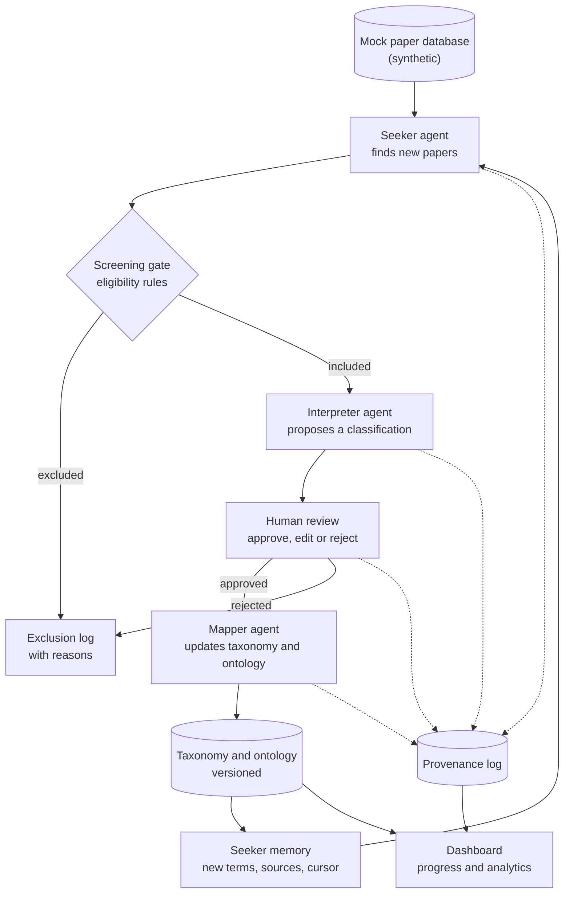

# FairDigit-NGO-Mapping system

A prototype that keeps an NGO's knowledge of addictive design up to date. It watches a (mock) paper database, screens new papers, interprets them with a human in the loop, and maps what they say into a versioned taxonomy and ontology of addictive design. A dashboard shows progress, analytics and new insights.

Built for LS3009 Legal Design Clinic on Fair Digital Transition, University of Aberdeen. Team: [Team name].

> **Prototype only.** It runs on synthetic data. The papers, authors and journals in the demo are invented. Nothing here is legal advice, and the tool does not decide whether anything is lawful.

**Quick start:** `pip install -r requirements.txt`, then `python run_demo.py` for a headless check, or start `uvicorn fake_site.main:app --port 8001` and `streamlit run pipeline/app.py` for the dashboard. Full steps are in [section 10](#10-run-it).

## 1. The challenge

From the module brief (lecture slide 30): complaints about social media platforms that appear to encourage compulsive use, especially among children and young people, have shot up. Analysing apps by hand (reviewing screenshots, recording sessions, comparing interfaces against consumer protection and online safety rules) is slow, expensive and hard to scale. The NGO FairDigit wants a digital tool to automate that process. The tool should not replace legal judgement. It should help flag problematic practices.

## 2. Where this prototype fits

To flag a practice, the tool first needs a defensible answer to two questions: what counts as addictive design, and which rules might apply to it. Both change as new research, guidance and enforcement appear. Doing that by hand is our "Stage 1" pain point from the user journey map: literature is out of date by the time it is reviewed, and classifying patterns and linking them to legal frameworks is manual.

This prototype is that knowledge layer. It keeps the taxonomy and ontology current, with every change traceable to a source and a human decision. A small flagging demo (section 8) shows how the taxonomy is then used on an app.

What it does not do:
- It does not decide that a practice is unlawful. Outputs say "may fall under" and always show the evidence.
- It does not produce a "definitive argument" on addictive design. The literature disagrees in places, so the system records disagreement instead of hiding it.
- It does not use real papers, real platform data or real people's data.

## 3. How it works



### The agents

| Agent | Does | Output |
|---|---|---|
| Seeker | Queries the paper database for papers newer than its last cursor, using search terms from its memory | Candidate papers |
| Screening gate (rules, no LLM) | Applies eligibility rules: date, language, jurisdiction, relevance score, duplicates, has a DOI, not flagged as retracted | Included or excluded, with a reason |
| Interpreter | Reads an included paper and proposes: summary, key claims, which taxonomy node it relates to (or "new pattern"), and a supporting quote | Interpretation with confidence |
| Human reviewer | Approves, edits or rejects the interpretation | Decision, logged |
| Mapper | Turns an approved interpretation into a taxonomy and ontology change, validates it against the ontology rules, and bumps the version | Taxonomy diff |

The orchestrator is plain code, not an LLM. It moves each paper through the stages, retries failures, and never lets an unreviewed interpretation reach the taxonomy.

### Seeker memory

"Memory" is a stored search profile, not LLM chat history: search terms, sources already processed, the last-seen cursor, and terms learned from newly added taxonomy nodes. When the taxonomy gains a new pattern, its name and synonyms become new queries, so the seeker looks for the right things next time.

## 4. Taxonomy and ontology

- **Taxonomy:** a tree of addictive design patterns (for example infinite scroll, autoplay, push notifications, pull to refresh), each with a definition, observable signals, sources, and a status of `canonical` or `candidate`.
- **Ontology:** the same content as a knowledge graph (RDF, using `rdflib`). Core classes: `Feature`, `Behaviour`, `Harm`, `LegalProvision`, `Source`. It follows the chain of harm from class: feature, the behaviour it is meant to trigger, then immediate and long-term harm. Features link to provisions that may apply (for example the UCPD, DSA Art 25, the Online Safety Act 2023) and to the papers that support the link.
- **Rules (symbolic layer):** the ontology enforces constraints that the LLM cannot override. Examples: every canonical node needs a definition and at least one source; a new pattern enters as `candidate` until a human promotes it; a link to a legal provision needs an approved interpretation. Rules are written as simple Python checks or SHACL shapes (`pyshacl`).

This is the hybrid pattern from the lecture: neural components (the LLM agents) propose, and a symbolic layer (the ontology and its rules) checks.

## 5. Human in the loop

The Interpreter's output is a proposal. The review screen shows the evidence first (the quote and the paper), then the AI's verdict, so reviewers judge the source instead of rubber-stamping the answer (the lecture's automation bias risk). We track how often reviewers edit or reject, since a rate near zero can mean the review has become a formality.

## 6. Provenance and accountability

Every step is written to a provenance log modelled on W3C PROV-O:
- **Entity:** a paper, an interpretation, a taxonomy version
- **Activity:** search, screening, interpretation, review, mapping
- **Agent:** each AI agent and each human reviewer

Any taxonomy node can be traced back to the paper, the agent output and the person who approved it. This gives the chain the lecture describes, from transparency through explainability and traceability to auditability and accountability.

## 7. Data

Synthetic only. The prototype ships 12 hand-written fictional papers in `fake_site/papers.json` (invented authors, DOIs like 10.0000/syn.001, titles ending "(synthetic)"); section 10 lists what each one tests. A fuller set (about 40 papers) could include deliberate test cases such as:
- clearly relevant papers
- off-topic papers
- duplicates
- papers outside the date or language rules
- a retracted paper
- a paper that introduces a new pattern not in the taxonomy
- a paper that contradicts an existing mapping
- a paper whose interpretation needs human correction

## 8. Flagging demo (links the prototype to the challenge)

A single page takes a synthetic "app observation" (a text description of a screen or session, for example "autoplay on by default, no stopping cue, streak counter with loss warning") and matches it against the current taxonomy. It returns candidate patterns, the provisions that may apply, the supporting sources, and a clear "for legal review" label. A lawyer decides. If an observation matches a pattern that was only added today, that shows why a living taxonomy matters.

## 9. Tech stack (all free)

| Part | Choice |
|---|---|
| Agents | Python 3.11+, plain functions coordinated by `pipeline/orchestrator.py` |
| Storage | SQLite (`pipeline/db.py`) |
| Ontology | not built yet (planned: `rdflib`, optional `pyshacl`); the canonical rule is a Python check |
| Dashboard | Streamlit |
| Live progress | not built; the dashboard reloads after each action |
| LLM | `mock` mode (default), local model through Ollama, or the Gemini free tier. Set with `LLM_MODE` in `.env` |
| Mock paper database | Small FastAPI app serving the synthetic data as HTML (`fake_site/`) |

`mock` mode returns scripted outputs, so the demo is repeatable and never depends on a rate limit or the network. Free-tier limits change, so check them before relying on one.

## 10. Run it

The working prototype is smaller than the full design above. It has three agents (Extractor, Interpreter, Updater) coordinated by plain Python, a Streamlit dashboard and SQLite. The ontology (rdflib, SHACL), PROV-O export, server-sent events and a React dashboard are not built; the activity log in `events` stands in for provenance.

Needs Python 3.11 or newer. Everything runs locally and offline in mock mode.

```bash
python -m venv .venv
```

```bash
.venv\Scripts\activate
```

(on macOS or Linux: `source .venv/bin/activate`)

```bash
pip install -r requirements.txt
```

```bash
copy .env.example .env
```

(on macOS or Linux: `cp .env.example .env`; `LLM_MODE=mock` is the default)

Headless check of the whole flow (starts and stops the fake site itself, uses its own database):

```bash
python run_demo.py
```

Tests:

```bash
python -m pytest -q
```

Live demo, two terminals, both from the repo root:

```bash
uvicorn fake_site.main:app --port 8001
```

```bash
streamlit run pipeline/app.py
```

Then open http://localhost:8501. To start again from scratch use the sidebar button **Reset demo**, or `python scripts/reset_demo.py`.

**Two separate apps.** `fake_site/` is the pretend publisher and owns the 12 synthetic papers. `pipeline/` owns the agents, `demo.db`, the seed taxonomy and the scripted model answers. The pipeline only talks to the fake site over HTTP and never imports from it.

```
fake_site/main.py              FastAPI site: /, /paper/{id}, /premium/paper/{id}, /terms,
                               /robots.txt, /.well-known/tdmrep.json, POST /admin/advance, /admin/reset
fake_site/papers.json          the 12 synthetic papers, in two batches
pipeline/db.py                 all SQLite access (demo.db)
pipeline/sources.py            SourceAdapter interface and FakeSiteAdapter (requests + BeautifulSoup),
                               robots.txt, tdmrep.json and tdm-reservation header checks
pipeline/extractor.py          Extractor agent: screening rules, exclusions with reasons, cursor
pipeline/terms.py              search terms = seed terms + every taxonomy keyword
pipeline/llm.py                ask_json(prompt, mock_key): mock, gemini or ollama
pipeline/interpreter.py        Interpreter agent: prompt and plain Python checks
pipeline/review.py             human decisions
pipeline/updater.py            Updater agent: taxonomy changes, version, canonical rule
pipeline/orchestrator.py       runs the agents in order
pipeline/flagger.py            "Flag an app" keyword matching
pipeline/app.py                Streamlit dashboard
pipeline/seed/taxonomy.json    seed taxonomy (7 categories) and seed search terms
pipeline/seed/mock_interpretations.json   scripted model answers, keyed by paper id
scripts/reset_demo.py          wipe and reseed
run_demo.py                    headless end to end check
tests/                         pytest tests
```

**Using a real model (optional, free).** Set `LLM_MODE=gemini` with a free `GEMINI_API_KEY` from Google AI Studio and `pip install google-genai`, or `LLM_MODE=ollama` after `ollama pull gemma3:4b`. The interpreter checks run the same way, so a real model's made-up quotes are caught just like the scripted one.

### The 12 synthetic papers

| Paper | Batch | What it tests | Expected |
|---|---|---|---|
| syn-001 | 1 | relevant, fits an existing category | included |
| syn-002 | 1 | relevant, needs a new category ("Ephemeral content") | included |
| syn-003 | 1 | off topic | excluded: no match |
| syn-004 | 1 | same DOI as syn-001 | excluded: duplicate DOI |
| syn-005 | 1 | published 2012 | excluded: outside 2015 to 2026 |
| syn-006 | 1 | retracted | excluded: retracted |
| syn-007 | 1 | German | excluded: not English |
| syn-008 | 1 | scripted answer has a made-up quote | included, quote check fires |
| syn-009 | 1 | Synthetic Press Premium | skipped: TDM opt-out respected |
| syn-010 | 2 | Synthetic Press Premium | skipped: TDM opt-out respected |
| syn-011 | 2 | only matches "ephemeral content", an approved keyword | excluded until that keyword is approved, then included |
| syn-012 | 2 | first model reply is broken JSON; abstract contains an instruction aimed at AI | retried once; flagged |

### The seed taxonomy

`pipeline/seed/taxonomy.json` has 7 canonical categories grouped by mechanism: endless and frictionless consumption, variable rewards, social feedback, notifications and re-engagement, streaks and loss aversion, personalisation and immersion, and monetisation pressure. It draws on the two source taxonomies listed in that file (Nature Reviews Psychology, 2023, doi:10.1038/s44159-023-00153-4; IEEE Transactions on Technology and Society, 2025). The full texts were paywalled or blocked when the seed was drafted, so **check the category names and definitions against the papers** before relying on them.

## 11. Demo script

1. Sidebar: **Run pipeline**. The Pipeline tab shows 3 papers included and 6 excluded, each with a reason. The premium paper is highlighted as "TDM opt-out respected".
2. Review queue: show the evidence (quotes) first. syn-008 has a red "quote not found" warning and that keyword starts unticked. Approve syn-001 and syn-002, and approve syn-008 without the made-up keyword.
3. Taxonomy tab: the version has gone up, "Ephemeral content" is a new candidate category, and the new keywords carry citations and provision links.
4. Search terms tab: "ephemeral content", "stopping cue" and the others appear, labelled with the paper they came from.
5. Sidebar: **Publish next batch**, then **Run pipeline**. syn-011 is picked up only because "ephemeral content" is now a search term. syn-012 shows the warning about instruction-like text.
6. Activity log: trace a keyword back to the paper, the interpreter output and the reviewer's decision.
7. Taxonomy tab: promote "Ephemeral content" to canonical (allowed because it has a definition and a citation).
8. Flag an app: the example description matches the new category. The result ends with "For legal review, not a finding".

## 12. Lecture questions (slide 30 and the "Some thoughts" slide)

**Where does it fit in the software development lifecycle?** Our own build is at the prototype and design stage. As a tool, it supports monitoring and audit of other people's software after deployment, which is where NGO scrutiny of live apps happens.

**What datasets do we need?** For the taxonomy: scholarly papers and policy documents (metadata and open-access text first), plus the text of the relevant laws and guidance. For flagging: labelled examples of addictive patterns in apps (screenshots, session logs) annotated by legal and HCI experts, and a held-out set to test accuracy. For this prototype: synthetic stand-ins.

**Which legal frameworks enable or prevent collecting that data?** See section 13.

**How plausible is it?** Technically plausible for monitoring literature and keeping a taxonomy current, because the output is reviewed by a person. Much harder for detecting violations from screenshots alone. Our literature review found that DSA Art 25 turns on whether users' decision-making is actually impaired (Liu, 2026, p 87), and that the line between addictive and merely attractive design is unclear. A screenshot cannot show impairment, so the tool should flag signals for a lawyer, not violations.

## 13. Legal and ethical notes

*Study notes for the module, not legal advice. Check the current text of each instrument before relying on it.*

**Collecting papers**
- Copying papers for text and data mining engages copyright. In the UK, CDPA 1988 s 29A permits copying for text and data analysis for non-commercial research with lawful access, and contract terms cannot override it. In the EU, the DSM Directive (2019/790) has a research exception (Art 3) and a general exception (Art 4) that rightholders can opt out of in machine-readable form.
- Bulk extraction from a publisher's database can also engage database rights, and licences often ban scraping or uploading content to third-party AI services. A real version would start with open sources and official APIs, store metadata and short derived facts instead of full text, and respect `robots.txt`.
- Author names and affiliations are personal data under the UK and EU GDPR even when public. Keep only what is needed for citation.

**Analysing papers with AI**
- Summaries can misstate what authors said. Always link to the source and keep a human sign-off.
- Statements about named platforms are risky if wrong or overstated. Use "may fall under", cite sources, and leave conclusions to lawyers.
- Fetched content is untrusted. A paper or web page can contain hidden instructions aimed at the agent (prompt injection). Agents treat fetched text as data, have no tools beyond what they need, and cannot write to the taxonomy without review.

**Agentic systems**
- EU AI Act: as we read it, an NGO's literature and flagging assistant is unlikely to be high-risk unless used by a regulator or court for the uses listed in Annex III, but check. Duties that may still apply include AI literacy (Art 4) and transparency about AI-generated content (Art 50). Label AI outputs as such.
- Human oversight and automation bias: see section 5.
- Who is to blame if the AI is wrong (lecture discussion question): the provenance log and version history exist so responsibility can be traced to the model output, the reviewer who approved it and the people who configured the system.
- GDPR Art 22 (automated decisions about individuals) is not engaged by the prototype but would be if a real version profiled individuals' sessions.

**If this became the real FairDigit tool (app data)**
- Screenshots and recordings of people using apps are personal data, and where children are involved the ICO's Children's Code and ethical approval for research with participants apply. Recruit with informed consent and minimise what is stored.
- Automating or emulating apps may breach platform terms. Bypassing access controls could engage the Computer Misuse Act 1990. The DSA gives vetted researchers a route to platform data (Art 40), so check its current status.

## 14. Limitations

Using the lecture's list of AI challenges:
- **Hallucination and repeatability:** an LLM can invent claims or classify the same paper differently on different runs. Mitigation: quotes required, human review, mock mode for demos.
- **Bias and domain drift:** the Interpreter reflects its training and our prompts, and the field's vocabulary changes. Mitigation: track reviewer overrides and re-check old mappings when the taxonomy changes.
- **Completeness:** the seeker only sees what the database exposes. The prototype searches one mock source.
- **Transparency:** LLM reasoning is a black box. We log inputs, outputs and decisions, but not the model's internal reasoning.
- **Scale:** tested on tens of papers, not thousands.

## 15. Team and workflow

- Roles: [name: mock database and seed data] [name: seeker and screening] [name: interpreter and review screen] [name: mapper, ontology and provenance] [name: dashboard and orchestration]. Adjust to team size.
- Contract first: shared JSON schemas in `contracts/` for `Paper`, `Interpretation`, `TaxonomyChange` and `ProvenanceEvent`. Change them only by agreement in the group chat.
- One branch per part, small pull requests, one reviewer per PR.
- Every part must run in `mock` mode and pass its tests before merging.
- Keep a project notebook in `docs/` for the module (decisions, problems, who did what).

## 16. Use of AI tools

[Fill in honestly: which AI tools the team used, for what (for example code generation, debugging, README drafting), and what the team checked or wrote itself. Match any declaration format the module requires.]

## 17. Sources

- Markovic, M. LS3009 Addictive Design: Technical Perspective, lecture slides, University of Aberdeen.
- Williams et al. From transparency to accountability of intelligent systems: moving beyond aspirations. doi:10.1017/dap.2021.37.
- W3C. PROV-O: The PROV Ontology.
- Liu, M. (2026) Addictive or just innocently attractive? Combatting social media addiction through the UCPD and the DSA. EuCML 15(2), 77-90.

## 18. Licence

[Choose one, for example MIT for the code. Synthetic data is for demonstration only.]
